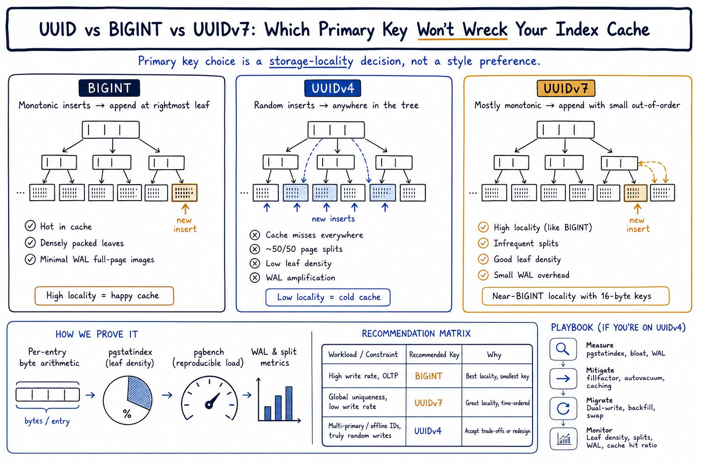

# Décisions league-s

## 001 · Erreurs métier : constantes typées par opération, vérifiées par `exhaustive`

**Date :** 2026-09-27
**Statut :** adoptée

### Contexte

Chaque handler traduit les erreurs métier du store en codes HTTP. Avec des sentinelles classiques (`var ErrNotFound = errors.New(...)`), rien ne signale un cas oublié : l'erreur tombe dans le `if err != nil` final et part en 500. On ne le voit qu'en test, ou en prod dans les logs.

Go n'a ni union de types ni `never` comme en TypeScript. Le compilateur ne peut donc pas vérifier qu'un `switch` couvre tous les cas.

### Décision

Chaque opération qui a des erreurs métier a son propre type d'erreur, basé sur `string`, avec ses erreurs déclarées en constantes :

```go
type CreateError string

func (e CreateError) Error() string { return string(e) }

const (
	ErrCreateLeagueNotFound CreateError = "league not found"
	ErrCreateNameTaken      CreateError = "team name is already taken in this league"
)
```

- Le store garde `error` comme type de retour, pour éviter le piège du `nil` typé.
- Le handler récupère l'erreur avec `errors.AsType[CreateError](err)`, puis fait un `switch` **sans `default`**.
- Le linter `exhaustive` (golangci-lint) signale tout `case` manquant. Il ne faut pas activer `default-signifies-exhaustive`.
- Le 500 reste **après** le `switch`, pour les erreurs inattendues (pgx, réseau…).
- Le message de la constante est celui renvoyé au client (`createErr.Error()`).
- Convention de nommage : `<Opération>Error` pour le type, `Err<Opération><Cas>` pour les constantes.

### Alternatives écartées

| Alternative | Pourquoi écartée |
|---|---|
| Sentinelles `errors.New` + `errors.Is` (la norme en Go) | Un oubli n'est détecté que par les tests. |
| Une fonction de mapping par package | Tous les handlers d'un package partagent le même mapping, et une nouvelle sentinelle peut y être oubliée. |
| L'erreur porte son status HTTP | Le domaine dépendrait de HTTP. |
| Un seul type d'erreur par package | `exhaustive` exigerait que chaque handler gère aussi les erreurs impossibles pour son opération. |
| Erreurs opaques + comportement (`NotFound() bool`, Dave Cheney) | Couplage minimal, mais pas de vérification d'exhaustivité. |

### Conséquences

- ✅ Chaque opération documente exactement ce qui peut échouer.
- ✅ Un cas oublié dans un handler est détecté au lint, en local et en CI.
- ✅ Les constantes sont immuables, contrairement à une `var` qu'un autre package pourrait réassigner.
- ⚠️ Ce n'est pas le pattern standard en Go : un lecteur Go s'arrêtera dessus. D'où ce document.
- ⚠️ Plus de code : un type par opération.
- ⚠️ La garantie est à sens unique : rien ne vérifie que le store ne renvoie *que* les erreurs de ce type. Les tests d'intégration couvrent chaque cas.
- ⚠️ Deux opérations peuvent avoir des erreurs de même sens mais distinctes (`ErrGetNotFound`, `ErrDeleteNotFound`). `errors.Is` ne les relie pas.
- ⚠️ `errors.AsType` doit recevoir le type valeur (`CreateError`), pas `*CreateError`. Avec le pointeur, le code compile mais ne trouve jamais l'erreur.

Les critiques de Cheney contre les sentinelles et les types d'erreur visent surtout le couplage des API publiques de librairies. Ici, tout est dans `internal/` et l'erreur est utilisée dans le package qui la définit.

### Références

- Dave Cheney, [Constant errors](https://dave.cheney.net/2016/04/07/constant-errors) (2016)
- Dave Cheney, [Don't just check errors, handle them gracefully](https://dave.cheney.net/2016/04/27/dont-just-check-errors-handle-them-gracefully) (2016)
- Blog Go, [Working with Errors in Go 1.13](https://go.dev/blog/go1.13-errors)
- [exhaustive](https://github.com/nishanths/exhaustive)
- Wesley Powell, [Better Golang Error Handling](https://dev.to/wspowell/better-golang-error-handling-182m) (2022), même approche

## 002 · Multi-tenant : une base partagée, isolée par ligue

**Date :** 2026-09-27
**Statut :** adoptée. Le Row-Level Security reste une option ouverte.

### Contexte

Plusieurs ligues amateurs utilisent la même API et la même base. Chaque ligue est un **tenant** : ses équipes, ses joueurs, ses saisons et ses matchs ne doivent jamais être visibles ni modifiables depuis une autre ligue.

### Décision

Une seule base, un seul schéma. Chaque table métier porte un `league_id`. L'isolation est assurée à deux niveaux.

**1. Dans le code**
- Toutes les routes sont sous `/api/v1/leagues/{leagueID}/...`. Le `league_id` vient toujours de l'URL, jamais du body.
- Chaque requête SQL filtre sur `league_id`. Une ressource d'une autre ligue répond 404, comme si elle n'existait pas.
- Des tests d'intégration vérifient les accès croisés (`"team of another league"`, `"season of another league"`).

**2. Dans la base**
- `team`, `player` et `season` ont une contrainte `UNIQUE (id, league_id)`.
- Les tables de liaison y font référence avec des clés étrangères composites, par exemple `season_team (team_id, league_id) → team (id, league_id)`. Postgres refuse donc de relier deux ressources de ligues différentes, même si le code a un bug.
- `match` n'a pas de `league_id` : il référence `season_team (season_id, team_id)`, qui est déjà isolé par ligue.
- Les unicités métier sont par ligue (`UNIQUE (league_id, name)`) : deux ligues peuvent avoir une équipe « Les Bleus ».

### Alternatives écartées

| Alternative | Pourquoi écartée |
|---|---|
| Un schéma Postgres par ligue | Meilleure isolation, mais chaque migration doit être appliquée N fois, et sqlc ou goose doivent gérer le schéma dynamiquement. Trop lourd pour des ligues amateurs. |
| Une base par ligue | Isolation maximale, mais un pool de connexions par ligue et une infra à gérer par client. Réservé aux besoins réglementaires ou aux gros clients. |
| Le tenant dans un header ou un sous-domaine | Moins visible qu'un segment d'URL, et plus dur à tester. L'URL rend le périmètre explicite dans chaque route. |

### Conséquences

- ✅ Simple à opérer : une base, une migration, un pool.
- ✅ En écriture, mélanger deux ligues demande deux erreurs à la fois : un filtre oublié dans le code *et* une contrainte absente dans le schéma.
- ⚠️ Un `WHERE league_id = $x` oublié dans une requête de **lecture** n'est pas bloqué par les clés composites : elles protègent les écritures, pas les lectures. Seuls les tests d'accès croisé le détectent.
- ⚠️ Pour l'instant, rien n'empêche d'écrire dans n'importe quelle ligue en changeant l'ID dans l'URL. L'authentification par ligue (prochaine étape de la roadmap) fermera ce trou : un admin de la ligue A n'aura de droits que sur la ligue A.

### Option ouverte : Row-Level Security (RLS)

Postgres peut filtrer lui-même les lignes par tenant, ce qui ajouterait un troisième niveau de protection et couvrirait aussi les lectures oubliées.

Principe :

```sql
ALTER TABLE team ENABLE ROW LEVEL SECURITY;

CREATE POLICY team_isolation ON team
    USING (league_id = current_setting('app.league_id')::bigint);
```

Pour chaque requête HTTP, dans une transaction :

```sql
SET LOCAL app.league_id = '42';
```

À prendre en compte avant de l'adopter :
- chaque requête HTTP devra ouvrir une transaction pour le `SET LOCAL`, sinon la valeur resterait sur la connexion du pool et fuirait vers la requête suivante ;
- le propriétaire des tables contourne le RLS par défaut : il faut une connexion avec un rôle applicatif distinct, ou `FORCE ROW LEVEL SECURITY` ;
- les migrations et les tests (`testdb`) devront se connecter avec un rôle qui contourne les policies, ou définir `app.league_id` ;
- les erreurs deviennent moins lisibles : une ligne filtrée par une policy ressemble à une ligne inexistante.

À réévaluer quand l'authentification par ligue sera en place, puisque c'est elle qui fournira le `league_id` de confiance.

### Références

- Postgres, [Row Security Policies](https://www.postgresql.org/docs/current/ddl-rowsecurity.html)

## 003 · Accès aux données : sqlc + pgx, sans ORM

**Date :** 2026-09-27
**Statut :** adoptée

### Contexte

L'API lit et écrit dans Postgres, avec un schéma riche : clés composites, contraintes nommées, enum `match_status`, dates. Il faut un accès aux données typé, testable, et qui laisse voir le SQL réellement exécuté.

### Décision

- **Le SQL est écrit à la main** dans `internal/database/queries/*.sql`, une requête nommée par opération (`-- name: GetTeamByID :one`).
- **sqlc génère le code Go** dans `internal/db` : une struct par table, une fonction typée par requête, et `Queries` pour les appeler. sqlc lit les migrations (`schema: "migrations"`), donc une requête qui ne correspond pas au schéma est refusée dès la génération.
- **Le driver est pgx v5** (`sql_package: "pgx/v5"`), utilisé directement avec `pgxpool`, sans passer par `database/sql`.
- **Les stores de domaine** (`internal/app/*/store.go`) enveloppent `db.Queries`. Ils convertissent les types générés en types du domaine et traduisent les erreurs Postgres (`*pgconn.PgError`, `pgx.ErrNoRows`) en erreurs métier (voir 001).
- Configuration : `emit_pointers_for_null_types` (une colonne nullable devient un pointeur), et des `overrides` pour avoir `time.Time` au lieu de `pgtype.Date` / `pgtype.Timestamptz`.

### Alternatives écartées

| Alternative | Pourquoi écartée |
|---|---|
| GORM | SQL généré implicite, erreurs découvertes à l'exécution, beaucoup de réflexion. Les clés composites et les contraintes nommées se gèrent mal. |
| ent | Schéma défini en Go et génération de code puissante, mais on s'éloigne du SQL, et le schéma ferait doublon avec les migrations goose. |
| `database/sql` ou sqlx écrit à la main | Même contrôle sur le SQL, mais les `Scan` et les structs sont à écrire et à maintenir soi-même, sans vérification contre le schéma. |
| Un query builder (squirrel, goqu) | Utile pour les requêtes dynamiques, mais le SQL devient moins lisible, sans typage des résultats. |
| pgx via `database/sql` | On perd des fonctionnalités propres à Postgres et à `pgxpool` (types natifs, meilleures performances), sans bénéfice ici puisque le projet ne cible que Postgres. |

### Conséquences

- ✅ Le SQL est lisible et relu comme du code. Aucune requête cachée.
- ✅ Une erreur de colonne ou de type est détectée à la génération, pas en prod.
- ✅ Pas de réflexion à l'exécution : le code généré est du Go simple, lisible dans `internal/db`.
- ✅ Les transactions restent explicites : `pool.Begin`, puis `q.WithTx(tx)`.
- ⚠️ Les requêtes dynamiques (filtres optionnels, tri variable) sont pénibles : il faut `sqlc.narg` et des `CASE` / `COALESCE`, ou une requête par variante. Ce sera à gérer pour les listes paginées.
- ⚠️ Il faut relancer `sqlc generate` après chaque modification de requête ou de migration. Le code généré est commité, et exclu du lint.
- ⚠️ Le code dépend de Postgres (types, codes d'erreur, noms de contraintes). C'est assumé : changer de base n'est pas un objectif.

### Références

- [sqlc](https://docs.sqlc.dev/)
- [pgx](https://github.com/jackc/pgx)

## 004 · Organisation du code : un package par domaine

**Date :** 2026-09-27
**Statut :** adoptée

### Contexte

Le code peut être découpé par couche technique (`handlers/`, `stores/`, `models/`) ou par domaine métier (`league/`, `team/`…). Le projet va grossir avec `squad`, `match`, puis l'authentification.

### Décision

Un package par domaine dans `internal/app/` :

```
internal/app/team/
├── team.go          type du domaine + erreurs métier
├── store.go         PostgresStore, au-dessus de db.Queries
├── handler.go       routes, DTO requête/réponse, traduction HTTP
├── handler_test.go  tests d'intégration
└── main_test.go     démarrage du Postgres de test
```

Le code partagé reste dans des packages techniques à part :
- `internal/db` : le code généré par sqlc ;
- `internal/httpx` : les helpers HTTP (`JSON`, `Error`, `Decode`, `IDParam`) ;
- `internal/testdb`, `internal/testhttp` : les helpers de test ;
- `internal/server` : l'assemblage des routes et des dépendances.

### Alternatives écartées

| Alternative | Pourquoi écartée |
|---|---|
| Par couche (`handlers/`, `stores/`, `models/`) | Courant en Node / NestJS, mais en Go le nom du package fait partie de l'identifiant. `handlers.CreateTeam` et `stores.TeamStore` se lisent moins bien que `team.Handler` et `team.GetError`. Chaque nouvelle fonctionnalité toucherait aussi tous les dossiers. |
| Architecture hexagonale / clean (`domain/`, `ports/`, `adapters/`) | Beaucoup de dossiers et d'interfaces pour une API de cette taille. À reconsidérer si la logique métier grossit, par exemple avec `match`. |
| Tout dans un seul package | Pas de frontière entre domaines, et des noms qui se marchent dessus (`ErrGetNotFound` existe dans chaque domaine). |

### Conséquences

- ✅ Tout ce qui concerne un domaine est au même endroit. Ajouter `squad`, c'est ajouter un dossier.
- ✅ Les noms se lisent avec leur package (`team.Handler`, `season.CreateError`), sans préfixe répété.
- ✅ Les détails restent privés au package : DTO, `toResponse`, `pathIDs` ne sont pas exportés.
- ⚠️ Go interdit les imports circulaires. `season` importe déjà `team` (pour `team.Team` dans `GetTeams`). Si un jour `team` a besoin de `season`, il faudra déplacer le type partagé ou passer par une interface.
- ⚠️ Il n'y a pas encore de couche service : le handler appelle directement le store. Une logique qui touche plusieurs domaines (transfert de joueur, résultat de match) demandera un service, prévu pour `match`.

## 005 · Routeur HTTP : chi ou `net/http.ServeMux` ?

**Date :** 2026-09-27
**Statut :** ouverte, à trancher

### Contexte

Le projet utilise chi (`github.com/go-chi/chi/v5`). Il s'en sert pour :
- les routes par méthode (`r.Get`, `r.Post`, `r.Delete`) ;
- les paramètres d'URL (`chi.URLParam` dans `httpx.IDParam`) ;
- les sous-routeurs : chaque domaine expose `Routes() chi.Router`, monté par `server` avec `r.Route("/api/v1", …)` et `r.Mount("/leagues/{leagueID}/teams", …)` ;
- les middlewares `middleware.Logger`, `middleware.Recoverer`, et `go-chi/cors`.

Depuis **Go 1.22**, le routeur de la stdlib (`http.ServeMux`) gère lui aussi :
- la méthode dans le pattern : `mux.HandleFunc("GET /leagues/{leagueID}/teams/{teamID}", h)` ;
- les paramètres d'URL : `r.PathValue("teamID")` ;
- le joker de fin `{path...}` ;
- la priorité au pattern le plus précis, et une réponse 405 automatique avec l'en-tête `Allow`.

Avant Go 1.22, un routeur tiers était presque indispensable. Ce n'est plus le cas, et beaucoup de projets Go récents s'en passent. La question se posera en entretien.

### Options

**A. Garder chi**
- ✅ Déjà en place et testé. chi est léger, idiomatique (handlers `net/http` standards) et très répandu.
- ✅ `Route` et `Mount` permettent à chaque domaine de déclarer ses routes en relatif, sans connaître son préfixe.
- ✅ Des middlewares prêts à l'emploi, groupables par sous-routeur (`r.With`, `r.Group`). Pratique pour l'auth par ligue à venir, qui ne concernera que certaines routes.
- ⚠️ Une dépendance de plus, alors que la stdlib couvre maintenant l'essentiel.

**B. Passer à `http.ServeMux`**
- ✅ Zéro dépendance pour le routage. C'est la tendance actuelle en Go.
- ✅ `r.PathValue` est standard : `httpx.IDParam` ne dépendrait plus de chi.
- ⚠️ Pas d'équivalent direct à `Mount` avec paramètres. `http.StripPrefix` n'accepte qu'un préfixe fixe, donc on ne peut pas monter un sous-routeur sous `/leagues/{leagueID}/teams`. Chaque domaine devrait enregistrer ses chemins complets, par exemple avec une fonction `team.RegisterRoutes(mux, prefix)`.
- ⚠️ Pas de système de middleware intégré : il faut envelopper les handlers soi-même (`func(http.Handler) http.Handler`) et écrire un petit helper pour les chaîner. En revanche, les middlewares de chi et `go-chi/cors` ont cette signature standard : ils restent utilisables sans le routeur chi.
- ⚠️ Une migration à faire : `Routes()` dans les quatre domaines, `server/routes.go`, `httpx.IDParam`, et les routeurs de test (`newTestRouter`).

### Questions à trancher

- La valeur « zéro dépendance » vaut-elle le travail de migration et la perte de `Mount` ?
- Comment l'auth par ligue sera-t-elle branchée ? Si elle doit s'appliquer à des groupes de routes, les groupes de chi sont un vrai avantage.
- Pour l'entretien : il faut pouvoir justifier le choix. « chi parce que `Mount` et les groupes de middlewares simplifient l'organisation par domaine » se défend aussi bien que « la stdlib suffit depuis Go 1.22 ».

Piste pour se décider : réécrire un seul domaine (`league`, le plus simple) avec `ServeMux` sur une branche, et comparer.

### Références

- Blog Go, [Routing Enhancements for Go 1.22](https://go.dev/blog/routing-enhancements)
- [`net/http.ServeMux`](https://pkg.go.dev/net/http#ServeMux)
- [chi](https://github.com/go-chi/chi)

## 006 · Identifiants : UUID v7 partout

**Date :** 2026-09-27
**Statut :** adoptée et appliquée

### Contexte

Toutes les tables utilisent des IDs `BIGSERIAL` (1, 2, 3…), visibles dans les URL : `/leagues/1/teams/42`. Ils sont faciles à deviner.

### Ce que cache la question

Des IDs devinables ne sont une faille que si **l'autorisation est absente**. Si `GET /leagues/1/teams/42` renvoie une équipe qu'on n'a pas le droit de voir, la faille est l'autorisation manquante, pas l'ID. C'est la faille n°1 du OWASP API Security Top 10 (« Broken Object Level Authorization »). Un UUID la rend seulement plus dure à trouver.

Les IDs séquentiels posent quand même deux vrais problèmes :
- **l'énumération** : on peut parcourir toutes les ressources avec une boucle de 1 à N ;
- **la fuite d'informations métier** : l'ID 42 révèle qu'il existe au moins 42 ligues, et l'écart entre deux IDs révèle le rythme des créations.

### Options

| Option | Pour | Contre |
|---|---|---|
| A. Garder `BIGSERIAL` partout | Rien à migrer. 8 octets, index compacts, IDs lisibles dans les logs et les tests. | Énumération et fuite du volume. |
| B. UUID v4 partout | Indevinable. | Aléatoire : chaque insertion tombe n'importe où dans l'index (voir les benchmarks). |
| **C. UUID v7 partout** | Indevinable en pratique, et ordonné dans le temps : les insertions restent en fin d'index. `uuidv7()` est natif depuis Postgres 18. | Révèle la date de création à la milliseconde. 16 octets au lieu de 8. |
| D. `BIGSERIAL` en interne + un identifiant public | Les jointures et les clés composites restent en `BIGINT`. | Deux identifiants par table, et une résolution à chaque requête. |
| E. UUID v7 seulement pour `app_user` et l'auth | Pas de migration des tables existantes. | Deux conventions d'ID dans le même projet. Les IDs publics restent énumérables. |

### Décision

**UUID v7 partout** (option C) :

```sql
id UUID PRIMARY KEY DEFAULT uuidv7()
```

- toutes les clés étrangères, y compris `league_id` dans les clés composites, passent en `UUID` ;
- sqlc génère `pgtype.UUID` par défaut. Un `override` le remplace par `github.com/google/uuid.UUID` ;
- `httpx.IDParam` parse avec `uuid.Parse` au lieu de `strconv.ParseInt`. Un ID mal formé répond toujours 400.

**Pourquoi maintenant :** il n'y a encore aucune donnée en prod, donc rien à convertir. La base locale doit déjà être recréée (Postgres 18 et migrations renumérotées). Et `squad`, `match` et l'auth vont ajouter des tables : chaque domaine ajouté rend la migration plus chère.

**Ce qui ne change pas :** un UUID n'est pas un contrôle d'accès. Chaque écriture passe par le middleware d'autorisation par ligue, et des tests 403 le vérifient.

### L'impact sur les performances

| Benchmark | Setup | bigint | UUID v7 | UUID v4 |
|---|---|---|---|---|
| Jeremy Schneider, ardentperf (fév. 2024) | 20 M lignes + 1 M insérées, 1 cœur, 2 Go de RAM | 3 480 TPS, index 1,97 Go | 3 420 TPS (−2 %), index 2,47 Go (+25 %) | 2 670 TPS (−23 %), index 2,65 Go |
| myDBA.dev | Postgres 18.0, 10 M lignes, 16 connexions, 8 vCPU | index 214 Mo, remplissage des pages 89,7 % | −12 % de TPS, index 302 Mo (+41 %), remplissage 87,2 % | −40 % de TPS, index 397 Mo, remplissage 65,4 % |
| Andrew Atkinson (août 2026), cas réel | Passage de UUID v1 à v7 sur une appli en prod | — | Une insertion multi-lignes passe de 0,7 ms à 0,03 ms (23 fois plus rapide) | — |

L'article de Supabase ne mesure que la vitesse de génération et la taille de stockage, pas le débit en écriture. Sa conclusion : la génération n'est quasiment jamais le goulot d'étranglement.

**Pourquoi v4 est lent et pas v7.** Un index B-tree est trié. Avec un ID croissant (bigint, v7), chaque insertion va dans la dernière page, qui reste en mémoire. Avec un ID aléatoire (v4), chaque insertion tombe sur une page différente : il faut la relire depuis le disque, la couper en deux quand elle est pleine (page split), et Postgres écrit plus de pages complètes dans le WAL. Résultat : des pages à moitié vides (65 % contre 87-90 %), un index plus gros, et un débit plus faible.



**Ce qui reste entre v7 et bigint :** 16 octets au lieu de 8 par clé. D'où un index 25 à 40 % plus gros (moins de lignes tiennent en mémoire), et de 2 à 12 % de débit en moins selon la charge.

**Pour ce projet :** des ligues amateurs, c'est quelques milliers de lignes par table. À cette échelle, les index tiennent entièrement en mémoire et la différence n'est pas mesurable. Le vrai piège à éviter était v4, et v7 l'évite.

### Conséquences

- ✅ Les IDs publics ne sont plus énumérables et ne révèlent plus le volume.
- ✅ Performances proches de bigint, contrairement à v4.
- ✅ Les IDs peuvent être générés côté Go si besoin (avant l'insertion, pour une transaction ou un import), sans aller-retour avec la base.
- ⚠️ Migration de tout le projet : 19 colonnes dans 7 migrations, environ 30 endroits dans le code Go, environ 90 lignes de tests.
- ⚠️ IDs moins lisibles dans les logs et les tests : les tests ne peuvent plus écrire `/leagues/999` pour un ID inconnu.
- ⚠️ La date de création se lit dans l'ID. Sans importance pour des données publiques.
- ⚠️ `ORDER BY id` trie par date de création, mais seulement à la milliseconde près. Pour un ordre garanti, trier sur `created_at`.

### Références

- OWASP, [API1:2023 Broken Object Level Authorization](https://owasp.org/API-Security/editions/2023/en/0xa1-broken-object-level-authorization/)
- Postgres, [UUID Functions](https://www.postgresql.org/docs/current/functions-uuid.html)
- Supabase, [Choosing a Postgres Primary Key](https://supabase.com/blog/choosing-a-postgres-primary-key) (2022)
- Jeremy Schneider, [UUID Benchmark War](https://ardentperf.com/2024/02/03/uuid-benchmark-war/) (2024)
- myDBA.dev, [UUID vs BIGINT Primary Key in Postgres](https://mydba.dev/blog/uuid-vs-bigint-primary-key-postgres)
- Andrew Atkinson, [PostgreSQL 18: 23x Faster Inserts With UUID v7](https://andyatkinson.com/postgresql-18-uuidv7) (2026)

Pour aller plus loin (trouvés pendant la recherche, pas lus en détail) :
- Scaling Postgres, [UUID vs Bigint Battle!!! (épisode 302)](https://www.scalingpostgres.com/episodes/302-uuid-vs-bigint-battle/)
- Umang Sinha, [PostgreSQL UUID Performance: Benchmarking Random (v4) and Time-based (v7) UUIDs](https://www.umangsinha.in/blog/postgresql-uuid-performance-benchmark)
- DevOps Daily, [Stop Using Random UUIDs as Primary Keys: uuidv7() Lands in PostgreSQL 18](https://devops-daily.com/posts/postgres-18-uuidv7-primary-keys)

## 007 · Entités riches pour la logique métier (à partir de `match`)

**Date :** 2026-09-27
**Statut :** adoptée, pas encore implémentée (prévue avec le package `match`)

### Contexte

Les domaines actuels (`league`, `team`, `player`, `season`) sont du CRUD : leurs types sont de simples structs de données, sans méthode, et toute la logique tient dans le store (traduction des erreurs) et le handler. On parle de modèle « anémique ». Pour du CRUD, c'est suffisant.

`match` est différent. Il a de vraies règles métier :
- un cycle de vie : `scheduled`, `live`, `finished`, `postponed`, `cancelled`, avec des transitions interdites (on ne termine pas un match annulé, on ne modifie pas le score d'un match terminé) ;
- des invariants : deux équipes différentes, un score complet ou absent, pas de score négatif, un score obligatoire pour terminer ;
- une règle réutilisée ailleurs : qui a gagné, dont le classement a besoin.

Si ces règles sont dispersées dans les handlers, le service et le SQL, elles finissent dupliquées ou oubliées.

### Décision

**Les règles vivent dans l'entité, sous forme de méthodes.** Le type `match.Match` n'est plus un sac de données : il ne peut changer d'état qu'en passant par ses méthodes, qui refusent les transitions invalides.

```go
type Match struct {
	id       uuid.UUID
	homeTeam uuid.UUID
	awayTeam uuid.UUID
	status   Status
	score    *Score
}

func NewMatch(seasonID, home, away uuid.UUID, matchday int) (*Match, error)

func (m *Match) Start() error
func (m *Match) SetScore(home, away int) error
func (m *Match) Finish() error
func (m *Match) Postpone() error
func (m *Match) Winner() (teamID uuid.UUID, draw bool, err error)
```

- **Des champs non exportés** : hors du package `match`, on ne peut pas écrire `m.status = "finished"`. En Go, l'encapsulation se fait au niveau du **package**, pas du type. Le store, qui est dans le même package, peut donc reconstruire un `Match` depuis une ligne `db.Match` sans exposer de setter public.
- **Des receivers pointeur** pour les méthodes qui modifient l'état (`Start`, `Finish`…).
- **Un constructeur `NewMatch`** qui valide les invariants et renvoie une erreur, au lieu d'un littéral `Match{…}` qui pourrait être invalide.
- **Des erreurs typées par opération** (décision 001) : `FinishError`, `SetScoreError`… Le handler les traduit en 409 ou 422, et `exhaustive` vérifie qu'aucune n'est oubliée.
- **Un type `Status` propre au domaine**, traduit depuis `db.MatchStatus` dans le store. Le domaine ne dépend pas du code généré.

**Un service orchestre, l'entité décide.** Le service applique le cycle « charger → appliquer la règle → sauvegarder » :

```go
func (s *Service) Finish(ctx context.Context, leagueID, matchID uuid.UUID) error {
	// dans une transaction :
	// m, err := store.GetForUpdate(ctx, tx, leagueID, matchID)
	// if err := m.Finish(); err != nil { return err }
	// return store.Save(ctx, tx, m)
}
```

Le service gère ce qui dépasse un seul match : la transaction, la concurrence, et les règles qui demandent d'autres données (une seule rencontre par équipe et par journée, un coup d'envoi pendant la saison).

**Les contraintes SQL restent en place** (`CHECK (home_team_id <> away_team_id)`, `CHECK (status <> 'finished' OR home_score IS NOT NULL)`…). Comme pour le multi-tenant (décision 002), c'est un deuxième niveau : l'entité donne des erreurs lisibles, et la base garantit la cohérence même en cas de bug.

**Le cycle de vie proposé** (à confirmer pendant l'implémentation) :

```
scheduled ──Start──► live ──Finish──► finished
    │  ▲
    │  └──Reschedule── postponed ◄──Postpone── scheduled
    └──Cancel──► cancelled
```

### Alternatives écartées

| Alternative | Pourquoi écartée |
|---|---|
| Modèle anémique + règles dans le service (« transaction script ») | Très courant en Go et suffisant pour du CRUD. Mais les règles de `match` seraient éparpillées entre les méthodes du service, et `standing.Compute` devrait réimplémenter `Winner`. Surtout, rien n'empêcherait un autre code de modifier `status` directement. |
| Les règles uniquement en SQL (`CHECK`, triggers) | Les invariants simples y sont déjà. Mais une machine à états en triggers est dure à lire et à tester, et les erreurs Postgres sont peu parlantes pour le client. |
| DDD complet (agrégats, interfaces de repository, architecture hexagonale) | Trop de cérémonie pour la taille du projet. On prend l'idée utile (l'entité protège ses invariants) sans le reste. |
| Des entités riches partout, y compris pour `league` ou `team` | Aucune règle à protéger aujourd'hui : ce serait du code en plus sans bénéfice. On enrichira un domaine quand il aura de vraies règles. |

### Conséquences

- ✅ Toutes les règles d'un match sont au même endroit, lisibles comme la spécification du métier.
- ✅ **Des tests unitaires purs**, sans base ni HTTP : `m.Finish()` sur un match annulé doit échouer. Ce seront les premiers tests de `make test` dans `internal/app`.
- ✅ `standing.Compute` réutilise `Match.Winner()` au lieu de réimplémenter la règle.
- ✅ Un état invalide ne peut pas être construit depuis l'extérieur du package.
- ⚠️ Deux styles dans le projet : des domaines CRUD anémiques et un domaine riche. C'est voulu, et c'est la règle à expliquer : on enrichit quand il y a des invariants à protéger.
- ⚠️ Plus de code : conversion `db.Match` ↔ `Match`, une couche service, et des getters si le handler a besoin de lire des champs non exportés.
- ⚠️ « Charger → modifier → sauvegarder » est exposé aux écritures concurrentes (deux admins qui saisissent un score en même temps). Il faut une transaction avec `SELECT … FOR UPDATE`, ou un verrou optimiste sur `updated_at`.
- ⚠️ Le store doit pouvoir reconstruire un `Match` dans n'importe quel état, y compris `finished`, sans repasser par les transitions. Cette reconstruction reste privée au package.

### Références

- Martin Fowler, [Anemic Domain Model](https://martinfowler.com/bliki/AnemicDomainModel.html)
- Martin Fowler, [Transaction Script](https://martinfowler.com/eaaCatalog/transactionScript.html)
- Effective Go, [Names](https://go.dev/doc/effective_go#names) (visibilité par la majuscule, au niveau du package)

## 008 · Squad : empêcher les passages qui se chevauchent

**Date :** 2026-09-27
**Statut :** ouverte, à trancher

### Contexte

Chaque passage d'un joueur dans une équipe est une ligne de `squad_membership`, avec `joined_on` et `left_on` (`NULL` tant qu'il est dans l'effectif). C'est de l'historique **métier** : les dates décrivent la réalité, pas les modifications de la base.

Aujourd'hui, la seule protection est l'index unique partiel `squad_membership_active_player` : un joueur ne peut pas avoir **deux passages actifs** dans la même saison. Il n'empêche pas deux passages **terminés qui se chevauchent** :

```
Équipe A  [2025-08-01 ─────────────── 2025-12-31]
Équipe B               [2025-10-01 ─────────────── 2026-01-31]
```

Via l'API, ce cas n'arrive pas : on ne peut rejoindre une équipe qu'après avoir quitté la précédente. Mais une saisie rétroactive, un import ou un bug pourrait le créer, et le classement ou les statistiques deviendraient faux. Le même trou existe pour les numéros de maillot (`squad_membership_active_number`).

### Options

Testées sur Postgres 18 (`postgres:18`, conteneur jetable). Les deux demandent l'extension `btree_gist`, pour combiner l'égalité sur des UUID et le chevauchement de dates dans un même index GiST.

**A. Une contrainte d'exclusion sur les colonnes actuelles** (disponible depuis longtemps)

```sql
CREATE EXTENSION IF NOT EXISTS btree_gist;

CONSTRAINT squad_membership_no_overlap EXCLUDE USING gist (
    player_id WITH =,
    season_id WITH =,
    daterange(joined_on, left_on, '[)') WITH &&
)
```

**B. Une contrainte temporelle Postgres 18** (`WITHOUT OVERLAPS`)

```sql
period daterange GENERATED ALWAYS AS (daterange(joined_on, left_on, '[)')) STORED,
CONSTRAINT squad_membership_no_overlap UNIQUE (player_id, season_id, period WITHOUT OVERLAPS)
```

`WITHOUT OVERLAPS` n'accepte pas d'expression (`daterange(joined_on, left_on)` donne une erreur de syntaxe). Il faut une vraie colonne de type plage, ici générée à partir des deux dates. C'est la syntaxe de la norme SQL:2011, et elle ouvre la porte aux clés étrangères temporelles (`PERIOD`) de Postgres 18.

**C. Ne rien ajouter** : la règle reste garantie par l'API et le futur service de transfert.

| | A. `EXCLUDE` | B. `WITHOUT OVERLAPS` | C. Rien |
|---|---|---|---|
| Garantie en base | ✅ | ✅ | ❌ |
| Schéma | inchangé | une colonne générée en plus | inchangé |
| sqlc | rien à changer | `period` apparaît dans `SELECT *` / `RETURNING *` avec un type `pgtype.Range` : il faut un override ou lister les colonnes | rien |
| Lisibilité | syntaxe GiST moins connue | proche de la norme SQL, très lisible | — |
| Intérêt en entretien | bon | très bon (fonctionnalité Postgres 18) | faible |

### Points à décider

- **Borne de fin exclusive (`'[)'`)** : `left_on` est alors le premier jour où le joueur n'est **plus** dans l'équipe. Un transfert le même jour (`left_on` = `joined_on` de la nouvelle équipe) est accepté. Avec `'[]'` (bornes incluses), ce même transfert serait refusé, puisque les deux périodes partageraient un jour. Testé : `'[)'` accepte le transfert le même jour et refuse un vrai chevauchement. Cette convention doit aussi être écrite dans le DTO et la doc de l'API.
- **Garder ou non `squad_membership_active_player`** : la nouvelle contrainte le couvre (deux passages ouverts se chevauchent toujours). Le supprimer simplifie le schéma, mais le store le traduit aujourd'hui en `ErrJoinPlayerAlreadyActive`. Il faudrait traduire la nouvelle contrainte à sa place (code `23P01`, `exclusion_violation`).
- **Les numéros de maillot** : faut-il la même garantie sur `(season_id, team_id, number)` ? Seulement si l'historique des numéros compte pour le métier.

Recommandation : **B**, avec `'[)'`, si le coût côté sqlc est acceptable. Sinon **A**, qui donne la même garantie sans toucher au schéma.

### Références

- Postgres, [Exclusion constraints](https://www.postgresql.org/docs/current/ddl-constraints.html#DDL-CONSTRAINTS-EXCLUSION)
- Postgres, [Range types](https://www.postgresql.org/docs/current/rangetypes.html)
- Postgres, [`btree_gist`](https://www.postgresql.org/docs/current/btree-gist.html)
- Postgres 18, [`CREATE TABLE`](https://www.postgresql.org/docs/18/sql-createtable.html) (`WITHOUT OVERLAPS`, `PERIOD`)

## 009 · Historique des modifications (audit)

**Date :** 2026-09-27
**Statut :** ouverte, à trancher avec l'authentification

### Contexte

Le projet garde l'historique **métier** (passages dans les effectifs, matchs terminés), mais pas l'historique **technique** : qui a modifié quoi, quand, et quelle était l'ancienne valeur. Dès qu'il y aura plusieurs admins par ligue, la question se posera : « qui a changé le score de ce match ? ».

**Postgres n'a pas de versioning natif.** La norme SQL:2011 prévoit des tables versionnées par le système (`WITH SYSTEM VERSIONING`, requêtes `AS OF`). SQL Server, MariaDB et Db2 les proposent, pas Postgres. Les backups et le point-in-time recovery restaurent une base entière à une date donnée, mais ne permettent pas d'interroger l'historique d'une ligne.

### Options

| Option | Principe | Pour | Contre |
|---|---|---|---|
| **A. Triggers + tables `*_history`** | À chaque `UPDATE` ou `DELETE`, un trigger copie l'ancienne ligne dans une table jumelle | Complet, invisible pour le code Go, l'historique garde le même schéma | Une table et un trigger par table suivie, à maintenir à chaque migration. L'utilisateur qui a fait la modif n'est pas connu du trigger sans une astuce |
| **B. Une table d'audit générique** | Un trigger unique écrit dans `audit_log` : table, id, opération, ancienne et nouvelle valeur en `JSONB`, date | Une seule table et une seule fonction pour tout le schéma | Requêtes moins pratiques (JSON), table qui grossit vite |
| **C. Audit dans le code Go** | Le service écrit un événement (« score modifié de 1-0 à 2-0 par X ») dans la même transaction | Connaît l'utilisateur et l'intention métier, facile à afficher | Oubli possible : une écriture qui ne passe pas par le service n'est pas tracée |
| **D. Capture des changements (CDC)** | Lire le WAL avec la réplication logique (Debezium…) | Aucun impact sur l'app, rien ne peut être oublié | Infra lourde, disproportionnée ici |

**Connaître l'auteur d'une modification** : un trigger ne sait pas quel admin est connecté, puisque l'app se connecte toujours avec le même rôle Postgres. Il faut transmettre l'utilisateur à la base, par exemple avec `SET LOCAL app.user_id = '…'` au début de la transaction, que le trigger lit avec `current_setting('app.user_id')`. C'est le même mécanisme que le RLS (décision 002), avec les mêmes contraintes : une transaction par requête.

### Pistes

- L'historique qui a une valeur métier (changements de score, statut d'un match) peut justifier **C**, parce qu'on veut l'afficher et savoir *qui* l'a fait.
- Pour un filet de sécurité global (« qui a supprimé cette équipe ? »), **B** est le plus simple à mettre en place.
- À trancher une fois l'authentification en place, puisque l'intérêt principal est de relier une modification à un admin.

### Références

- Postgres, [Trigger functions](https://www.postgresql.org/docs/current/plpgsql-trigger.html)
- Postgres, [Logical replication](https://www.postgresql.org/docs/current/logical-replication.html)
